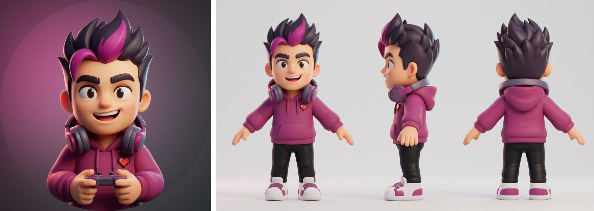

# 3D-Figuren-Workflow mit Claude Code

Repo: https://github.com/tobisattler/3d-figuren-workflow

Aus einem Konzeptbild wird eine animierbare 3D-Spielfigur: ein GLB mit modelliertem Gesicht, Ausdrücken, Rig und Animationen.
So haben wir es im November 2026 an mehreren Figuren gemacht. Die Hauptfigur war „Sid“, ein stilisierter Avatar im Spielzeugfigur-Look mit etwa 3 Kopflängen.



## Der Ablauf in einem Satz

Ein **Bildgenerator** macht das Turnaround-Blatt. **Pixal3D** macht daraus lokal die Form mit Textur. Danach baut ein **Claude-Fable-5.2-Subagent** (Effort xhigh) in **Blender** headless in mehreren abgegrenzten Runden weiter:
1. Gesicht und Ausdrücke,
2. Accessoires als eigene Objekte,
3. Aufräumen,
4. Rig.

Jede Runde prüft der Agent mit festen Prüfblättern, und am Ende steht eine Sichtprüfung durch einen Menschen.

| Stufe | Werkzeug | Zeit (bei uns) |
|---|---|---|
| 1. Konzept + Turnaround | Bildgenerator mit Referenzbild (bei uns Gemini „Nano Banana 2.1“) | Minuten, ~0,06 $ pro 2K-Blatt |
| 2. Blatt zerlegen | `tools/split_turnaround.py` | Sekunden |
| 3. Form + Textur | Pixal3D Multi-View (MIT) in ComfyUI, `tools/img23d.py` | 2–4 min auf einer RTX 2080 Ti |
| 4. Gesicht, Ohren, Accessoires, Aufräumen | Fable 5.2 xhigh + Blender 5.2.3 headless, Vorlagen in `briefs/` | je Runde 1–3 h |
| 5. Rig + Testanimationen | Fable 5.2 xhigh + Rigify, `briefs/05_rig.md` | ~3 h |
| 6. Export + Ansicht | `tools/blender/export_glb.py`, `tools/viewer/index.html` | Minuten |

Ausführlich: [docs/02-ablauf.md](docs/02-ablauf.md).

## Was im Repo liegt

```
skills/3d-figuren-workflow/SKILL.md   Claude-Code-Skill: Ablauf, Regeln, Stolperfallen (einbinden, siehe unten)
briefs/                               Auftragsvorlagen für die Fable-Subagenten (eine Datei pro Runde)
tools/img23d.py                       Turnaround-Bilder -> GLB über ComfyUI + Pixal3D (startet und stoppt ComfyUI selbst)
tools/comfyui/install.sh              ComfyUI v0.44.1 + Pixal3D-Modelle installieren
tools/comfyui/workflows/              der Pixal3D-Multi-View-Workflow im API-Format (aus dem Comfy-Template)
tools/split_turnaround.py             3-Ansichten-Blatt -> drei quadratische Einzelbilder im gleichen Maßstab
tools/fix_normal_map.py               kaputte Stellen in der Generator-Normal-Map neutralisieren
tools/blender/                        Prüfblätter (Körper, Gesicht, Roh-GLB) und GLB-Export
tools/viewer/index.html               three.js-Viewer: drehen, Ausdrücke per Regler, Animationen abspielen
examples/                             Notizen der Fable-Läufe an Sid und das Export-Skript mit Rig
docs/                                 Setup, Ablauf, Aufträge, Lehren, Lizenzen und Kosten
```

## Schnellstart

0. **Holen:** `git clone https://github.com/tobisattler/3d-figuren-workflow.git && cd 3d-figuren-workflow`
1. **Voraussetzungen:**
   - Claude Code mit Zugriff auf **Fable 5.2**,
   - eine NVIDIA-GPU mit mindestens 11 GB VRAM (bei uns eine RTX 2080 Ti),
   - Linux mit `uv`, `git`, `curl`,
   - Blender 5.2.3,
   - Python 3 mit `pillow`, `numpy`, `opencv-python`.

   Details: [docs/01-setup.md](docs/01-setup.md).
2. **Skill einbinden:**
   ```bash
   mkdir -p ~/.claude/skills && cp -r skills/3d-figuren-workflow ~/.claude/skills/
   # optional, aber empfohlen: die Blender-Skills (MIT), siehe docs/01-setup.md
   ```
3. **Pixal3D installieren:** `COMFY_BASE=~/comfy tools/comfyui/install.sh`. Das lädt etwa 9,3 GB Modelle.
4. **Testlauf** mit einem Turnaround-Blatt (vorne | Seite mit Blick nach Bild-links | hinten):
   ```bash
   python3 tools/split_turnaround.py blatt.png out figur
   COMFY_BASE=~/comfy python3 tools/img23d.py --views out/figur_front.png out/figur_side_left.png out/figur_back.png --out figur_px.glb
   blender -b --python tools/blender/px_review.py -- figur_px.glb review/
   ```
5. **Fable-Runde starten:** In Claude Code zum Beispiel so:
   > Lies briefs/02_gesicht.md, setze die Platzhalter für meine Figur ein und starte einen Subagenten mit Modell fable, Effort xhigh, im Hintergrund. Zeig mir danach das Prüfblatt.

   Der Skill erklärt dem Hauptagenten, wie er koordiniert: Auftrag schreiben, Prüfblatt ansehen, Vorher/Nachher-Vergleiche zeigen und zwischen den Runden Checkpoints anlegen.

## Wichtigste Lehren

- **Seitenansicht richtig belegen:** Pixal3D-Slot `left` erwartet die Figur mit **Blick nach Bild-links**. Falsch belegt, oder ohne Rückansicht, bekommt der Hinterkopf ein zweites Gesicht.
- **3D-Modellieren mit Fable 5.2 auf Effort xhigh:** Im Blindtest war es sichtbar besser als Opus 5.5, und auch besser als Fable mit high oder medium.
- **Accessoires als eigene Objekte:** Kopfhörer, Brille oder Mütze schneidet man aus dem Generator-Mesh heraus und baut sie neu.
- **Risse und dunkle Nähte** auf Pixal3D-Modellen kommen meist aus der Normal-Map, nicht aus der Geometrie.
- **Automatische Scores** (Silhouetten-IoU, DINO) taugen für grobe Unterschiede. Die feinen entscheidet der Blick auf das Modell aus Schrägansichten.

Alle Lehren: [docs/04-lehren.md](docs/04-lehren.md).

## Lizenzen

- **Unser Code:** MIT, siehe `LICENSE`.
- **Werkzeuge, die wir nutzen:**
  - Pixal3D: MIT.
  - ComfyUI: GPL-3.0, nur als Werkzeug.
  - Blender: GPL, nur als Werkzeug.
  - DINOv3: Meta-Lizenz. Kommerzielle Nutzung ist erlaubt, Militär und ITAR sind ausgeschlossen, und die Lizenz muss bei Weitergabe mitgegeben werden.
  - BiRefNet: MIT.

Details: [docs/05-lizenzen-kosten.md](docs/05-lizenzen-kosten.md).
