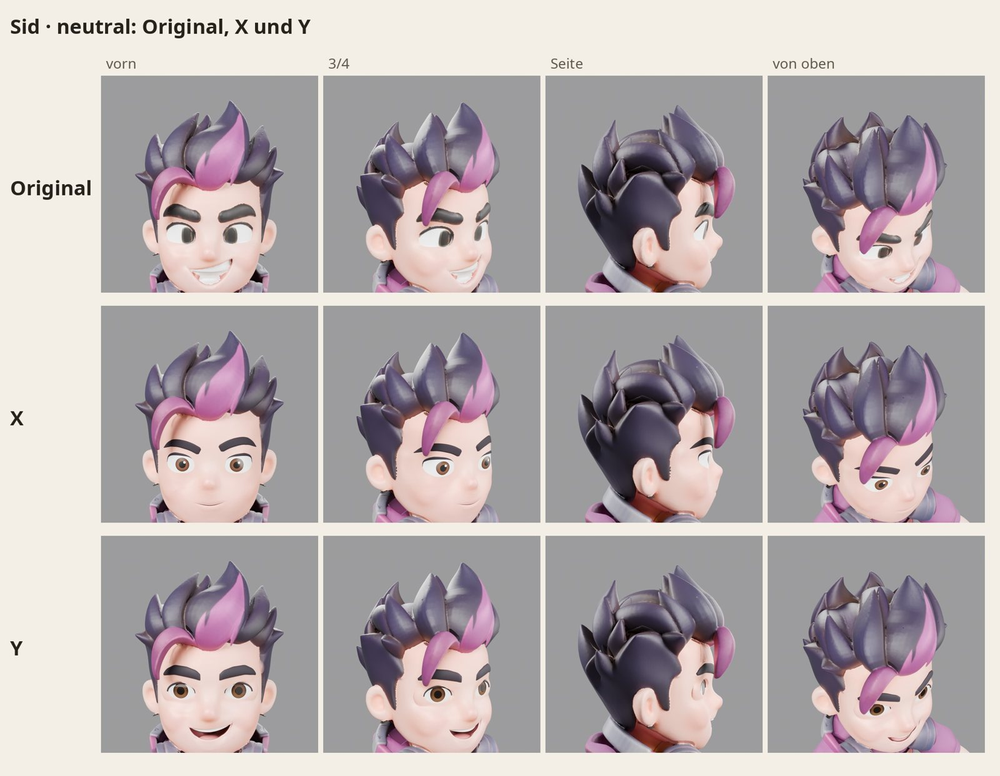
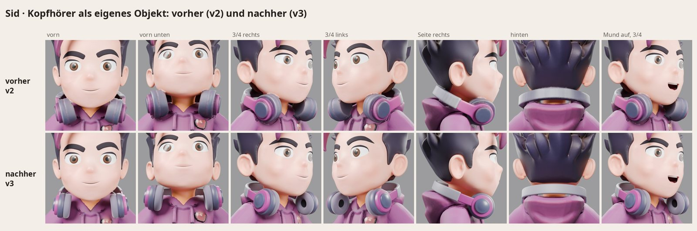
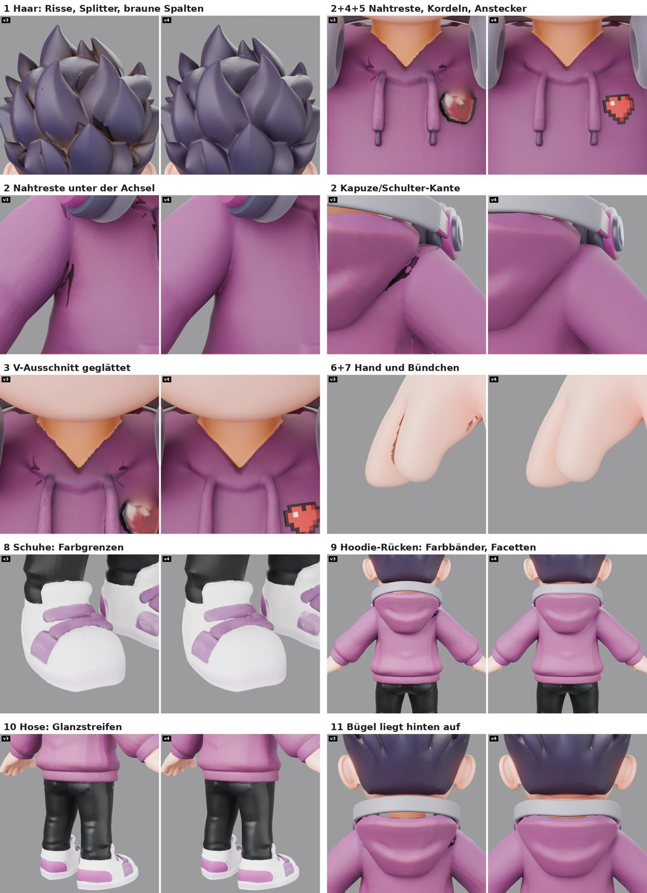
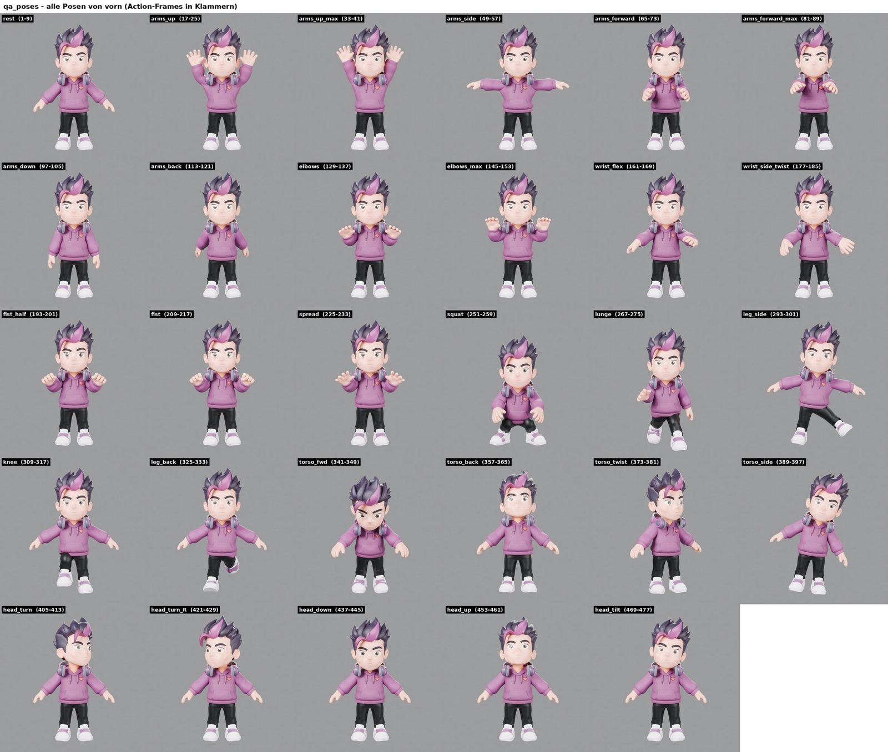
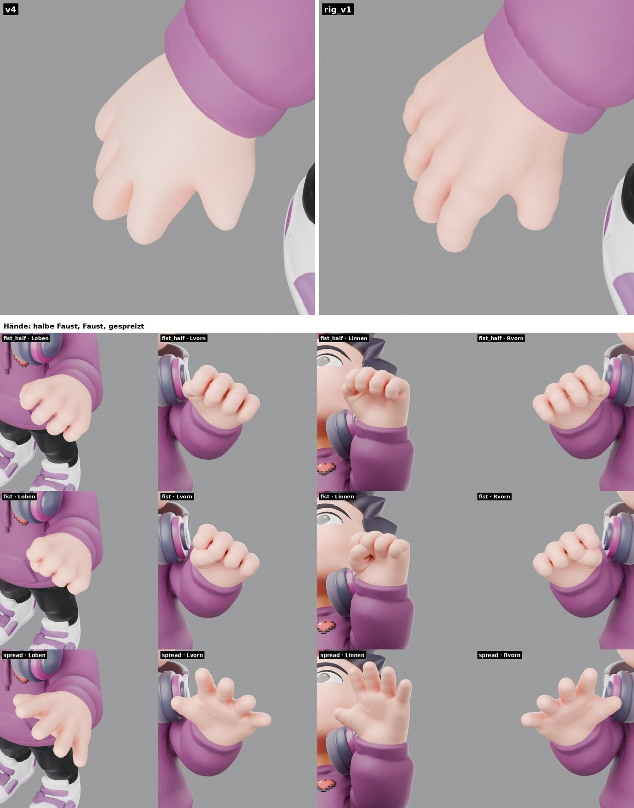

# Der Ablauf, Stufe für Stufe

**Rollen:**
- **Hauptagent (Koordinator):** schreibt die Aufträge, startet die Subagenten, sieht sich die Prüfblätter an, legt Checkpoints an und zeigt dem Menschen Vorher/Nachher.
- **Fable-5.2-Subagenten (Effort xhigh):** machen die eigentliche 3D-Arbeit, jeweils eine abgegrenzte Runde pro Auftrag.
- **Mensch:** entscheidet nach jeder Runde anhand der Bilder und des Viewers.

Konventionen für alle Stufen:
- Meter, Z nach oben, die Figur blickt nach −Y, der Ursprung liegt am Boden, Ruhepose ist die A-Pose.
- Eine stilisierte Figur ist bei uns etwa 1,0 m hoch.

## 1. Konzept und Turnaround

**Ziel:** ein Blatt mit drei Ansichten nebeneinander:

`vorne | Seite, Blick nach Bild-links | hinten`

Bei uns im Format 16:9 in 2K, alle Ansichten im selben Maßstab: Scheitel und Sohlen auf denselben Pixelzeilen.

**Regeln, die sich bewährt haben:**
- **Referenzbild:** das Konzept- bzw. Avatarbild der Figur. Bleiben die Proportionen dabei nicht stabil (3 von 6 Figuren kamen mit 5–6 statt 3 Kopflängen zurück), kommt ein bereits abgenommenes Turnaround-Blatt einer anderen Figur als **zweite Referenz** dazu. Dann lautet der Prompt: „Figur aus Bild 1, Proportionen, Stil, Pose und Licht aus Bild 2“. Damit klappten 5 von 5 im ersten Versuch.
- **Pose:** A-Pose mit Armen etwa 30–35° vom Körper, die Hände offen und leer. Requisiten in der Hand werden später eigene Objekte.
- **Bildaufbau:** neutrales, weiches Licht, einfarbig hellgrauer Hintergrund, keine Schlagschatten und keine Bodenlinie, keine Texte.
- **Rückansicht ist Pflicht.** Ohne sie erfindet Pixal3D ein Gesicht am Hinterkopf.

**Der Prompt für Sid** (Nano Banana 2.1, 2K, 16:9, das Avatarbild als Referenz):
> Character turnaround sheet of exactly the character in the reference image: same face, spiky dark hair with a magenta streak, big headphones around the neck, magenta hoodie with a small pixel-heart pin, same colours and the same stylised 3D toy-figure render style, about 3 heads tall. Full body, three views side by side on one wide image: left a front view, middle a side view in profile facing image-left, right a back view. All three views at exactly the same scale and height: top of the head on one horizontal line and the soles of the feet on one horizontal line. Standing in a relaxed A-pose, arms angled about 30 degrees away from the body, hands open and empty, feet slightly apart. Black jeans and white sneakers with magenta details. Straight-on camera at mid-body height with minimal perspective. Plain light grey seamless background, even soft lighting, no cast shadows on the background, no floor line. No text, no labels, no game controller in the hands.

**Zerlegen:**
```bash
python3 tools/split_turnaround.py blatt.png out figur
# -> out/figur_front.png, out/figur_side_left.png, out/figur_back.png
```
Das Skript findet die drei Figuren über den Abstand zur Hintergrundfarbe. Jede Figur kommt auf ein quadratisches Bild in voller Blatthöhe, so bleiben Maßstab und Höhe gleich. Den Rand füllt es zeilenweise mit der Hintergrundfarbe auf, damit keine Naht entsteht.

## 2. Form und Textur mit Pixal3D

```bash
python3 tools/img23d.py --views out/figur_front.png out/figur_side_left.png out/figur_back.png --side-faces left --out figur_px.glb
blender -b --python tools/blender/px_review.py -- figur_px.glb review_px/   # 9 Ganzkörper- und 7 Kopfansichten
blender -b --python tools/blender/px_review.py -- figur_px.glb review_px_nonorm/ nonorm   # dasselbe ohne Normal-Map
```

- **Seitenkonvention:**
  - Slot `left` = Figur blickt nach **Bild-links**, Slot `right` = Blick nach Bild-rechts.
  - Die Gegenseite spiegelt `img23d.py` selbst.
  - Hat der Hinterkopf ein zweites Gesicht, liegen die Seiten falsch. Dann mit `--swap-sides` neu rechnen.
  - Mit richtig belegten Seiten stieg unser Ähnlichkeitsmaß von 0,85 auf 0,92.
- **Ergebnis:** ein einziges verschmolzenes Mesh mit rund 200k Faces. Haut, Kleidung, Haare und Accessoires sind eine Fläche mit gemeinsamer Textur aus BaseColor, Normal-Map und ORM.
  - Gesichtszüge sind nur aufgemalt oder grob geformt.
  - Finger sind oft zu Fäustlingen verschmolzen.
- **Ins .blend:** GLB importieren und Konventionen anwenden: Meter, Blick nach −Y, Ursprung am Boden.
- **Vor der Übergabe an Fable:** Die Datei und ihr Prüfblatt sind der Ausgangsstand, beides schreibgeschützt ablegen (Checkpoint v0).

## 3. Runden mit Fable 5.2 (Effort xhigh)

Pro Runde gibt es einen Auftrag aus `briefs/`, eine Arbeitskopie des letzten Checkpoints und feste Prüfblätter. Die Reihenfolge bei Sid:

| Runde | Auftrag | Was passiert ist | Dauer |
|---|---|---|---|
| v1 Gesicht | `briefs/02_gesicht.md` | Augäpfel mit Iris und Pupille, Lider aus der Gesichtshaut, Brauen, Wimpern, Mund mit Zähnen und Zunge. 8 Ausdrücke als Shape Keys `expr_*` mit Treibern, dazu Blickrichtung `eye_look_*` | 81 min, ~500k Tokens |
| v2 Feinschliff | (frei, nach Rückmeldung) | Ohren, Ohransatz und Koteletten neu modelliert und ins Mesh eingenäht | nicht notiert |
| v3 Accessoires | `briefs/03_accessoires.md` | Kopfhörer aus dem Körper geschnitten, Kinn, Hals und Kragen geschlossen, Bügel und Muscheln als drei eigene Objekte mit 4–6 mm Abstand neu gebaut | ~50 min |
| v4 Aufräumen | `briefs/04_aufraeumen.md` | 11 Stellen behoben: Haarsplitter, Nahtreste, V-Ausschnitt, Hände, Bündchen, Schuhe, Glanzstreifen und mehr. Ursache der meisten „Risse“ war die Normal-Map | Rahmen 3 h |
| Rig v1 | `briefs/05_rig.md` | Rigify-Steuer-Rig plus Spiel-Skelett mit 62 Knochen (Namen nach Godots Humanoid-Profil). Gewichte entlang der Knochenketten gerechnet, Hände mit fünf getrennten Fingern neu gebaut, 29 Prüfposen, Idle/Walk/Wave | knapp 3 h |


*Blindtest Gesicht. Oben das Pixal3D-Original mit aufgemaltem Gesicht, darunter X (Fable 5.2 xhigh) und Y (Opus 5.5 xhigh). Gewählt wurde X: „deutlich besser“, wirklich neutral, ohne Dellen.*



**Was der Koordinator in jeder Runde tut:**
1. **Arbeitskopie anlegen:** Kopie des letzten Checkpoints. Den Checkpoint selbst schreibgeschützt lassen.
2. **Auftrag ausfüllen:** Ausgangslage, Ziel, Arbeitsweise und Abgabe. Was der Mensch bisher abgelehnt hat, steht mit drin.
3. **Subagent starten:** Modell `fable`, Effort `xhigh`, im Hintergrund. Ein Zeitrahmen von 2–5 h als Obergrenze, mit „hör auf, wenn Du zufrieden bist“.
4. **Abgabe prüfen:**
   - die Prüfblätter selbst ansehen,
   - Vorher/Nachher mit gleicher Kamera und gleichem Licht,
   - Zahlen-Checks: nicht-mannigfaltige Kanten, lose Teile, Abstände.
5. **Dem Menschen zeigen:** ehrlich, mit Schwächen. Nach seinem Ja wird die Abgabe zum neuen Checkpoint (`checkpoints/vN`, schreibgeschützt).



## 4. Rig

- Die Vorlage `briefs/05_rig.md` ist bewusst offen gehalten. Sie nennt die Stellen, an denen es meist hakt:
  - Schultern und Achseln,
  - Ellbogen und Knie,
  - Candy-Wrapper am Handgelenk,
  - Schritt und Hüfte,
  - Kapuze beim Drehen des Kopfes,
  - die Finger.
- Höchstens 4 Einflüsse pro Punkt, weil three.js nicht mehr kann.
- Im .blend liegt ein Steuer-Rig zum Animieren. Exportiert wird nur ein sauberes Deform-Skelett mit Wurzel am Boden.
- Prüfposen als Action `qa_poses`, dazu `anim_idle`, `anim_walk` und `anim_wave`.

**Ergebnis bei Sid:**
- Formelgewichte entlang der Knochenketten, danach geglättet, hielten in allen 29 Prüfposen.
- Heat- bzw. Auto-Gewichte auf dem dichten, verschmolzenen Generator-Mesh waren unruhig und zogen Kapuze und Haare mit.




## 5. Export und Ansicht

```bash
blender -b figur.blend --python tools/blender/export_glb.py -- --out figur_web.glb --meshopt          # ohne Rig
# mit Steuer-Rig: Deform-Skelett vorher backen, Vorlage examples/sid_rig/export_glb_sid.py
python3 -m http.server   # dann http://localhost:8000/tools/viewer/index.html?model=../../figur_web.glb
```

- Beim Export stehen alle Shape Keys auf 0, Texturen gehen als WebP mit, und es gibt Meshopt.
- **Meshopt quantisiert die Positionen.** Liegen Schichten näher als etwa 0,5 mm beieinander (eine Iris auf dem Augenweiß), flimmern sie in three.js. Solche Modelle ohne `--meshopt` exportieren.
- **Animationen mit Meshopt:** Blenders Exporter packt die Rotationen mit 8 bit, das sind bis 1,7° pro Knochen und etwa 6 mm an den Fingerspitzen. `export_glb.py` stellt auf 16 bit, der Decoder bleibt derselbe.
- **Farben aus prozeduralen Blender-Shadern kommen im Browser nicht an.** Vor dem Export auf Texturen backen.

## 6. Prüfen, in jeder Stufe

- **Feste Prüfblätter**, immer dieselben Kameras, damit Vorher und Nachher deckungsgleich sind:
  - `tools/blender/face_sheet.py`: Kopf aus 5 Richtungen, dazu jeder `expr_*`-Key einzeln.
  - `tools/blender/body_sheet.py`: 31 Ansichten von Figur, Torso, Händen, Füßen, Beinen und Haaren. Mit `--only` gehen einzelne Ansichten.
  - Für realistische Proportionen `--head-frac 0.14` setzen.
- **Schrägansichten:** ¾ vorne, ¾ hinten, von oben, von unten. Abstehende Teile und Dellen sieht man nur schräg.
- **Automatische Scores** (Silhouetten-IoU, DINO-Ähnlichkeit) reichen für grobe Abstände. Die feinen Unterschiede bewertet der Mensch im Viewer.
- **Stillstand beim Score** (bei uns um 0,86) heißt: Eingabe oder Methode wechseln statt weiter iterieren.
